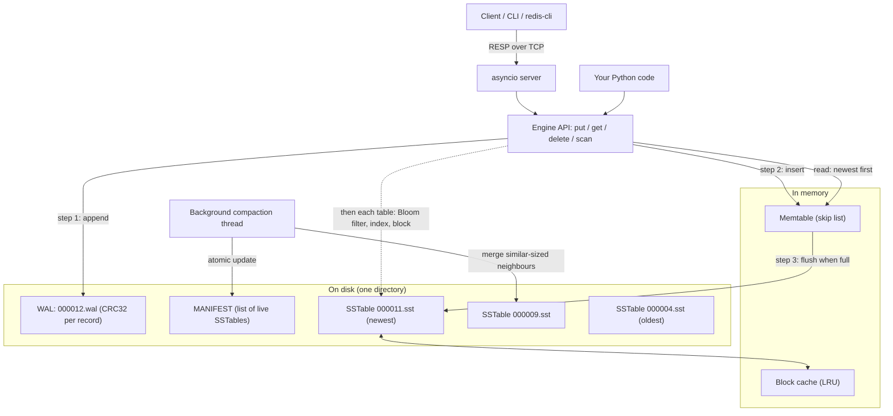
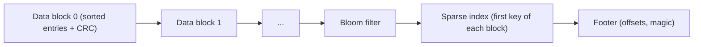

# Stratum

Stratum is a persistent key-value storage engine built on a
**log-structured merge tree (LSM tree)**, written in Python using only the
standard library. It keeps your data safe across crashes with a
write-ahead log, stores it in sorted, immutable files with Bloom filters,
and merges those files in the background. It also ships a small
Redis-compatible TCP server, a Python client and an interactive shell.

It is a learning project: every part (skip list, Bloom filter, SSTable
format, compaction, crash recovery) is implemented by hand and kept small
enough to read in one sitting.

```python
from stratum import Stratum

with Stratum("data") as db:
    db.put(b"user:1", b"Ada")
    db.put(b"user:2", b"Grace")
    db.get(b"user:1")                       # b'Ada'
    db.delete(b"user:2")
    list(db.scan(b"user:", b"user;"))       # [(b'user:1', b'Ada')]
```

## Architecture



Layout of one SSTable file:



### Write path

1. **Append to the WAL.** The key and value are written to the
   write-ahead log with a CRC32 checksum (and fsync'd if `sync=True`).
   From this point the write survives a crash.
2. **Insert into the memtable.** The memtable is a skip list, a sorted
   in-memory structure. The write is now visible to readers, and `put`
   returns.
3. **Flush when full.** Once the memtable reaches about 4 MiB it is
   written out, in sorted order, as a new immutable **SSTable**. The
   MANIFEST is then replaced atomically to record the new table, and the
   old WAL is deleted, since the table now holds that data.
4. **Compact in the background.** A background thread merges groups of
   similar-sized SSTables into one, dropping overwritten values and
   tombstones that are no longer needed.

A **delete** is just a write of a special marker called a *tombstone*.
The old value is physically removed later, during compaction.

### Read path

A `get(key)` checks the newest data first and stops at the first answer:

1. **Memtable.** If the key is there (as a value or a tombstone), done.
2. **Each SSTable, newest to oldest.** For each table:
   - is the key inside the table's min/max key range? If not, skip it;
   - ask the table's **Bloom filter**. "Definitely not here" skips the
     table without any disk read;
   - binary-search the in-memory **sparse index** to find the one block
     that could hold the key;
   - read that block (from the block cache, or with one `pread`), verify
     its checksum, and binary-search inside it.

A **range scan** opens a sorted iterator on the memtable and on every
SSTable and merges them with a heap. When the same key appears in several
places, the newest one wins and the others are skipped; tombstones hide
the key.

### Crash recovery

On startup Stratum reads the MANIFEST, deletes any file it does not
mention (leftovers from an interrupted flush or compaction), replays the
WAL into a memtable, and cuts off a torn final record if the crash
happened mid-write. Every step that changes the set of live files goes
through one atomic rename of the MANIFEST, so the database is always in
either the "before" or the "after" state.

## Design trade-offs

| Choice | What you gain | What it costs |
|---|---|---|
| LSM tree instead of a B-tree | Writes are sequential appends, so they are fast | A read may check several files; background compaction work |
| Write-ahead log | No acknowledged write is lost in a crash | Every write is written twice (WAL now, SSTable later) |
| `sync=True` by default | Survives OS crash / power loss | Slower writes than `sync=False` |
| Bloom filter per table (10 bits/key) | Most "key not in this file" checks need no disk read | About 1.25 bytes of RAM per key; ~0.8% false positives |
| Sparse index (one entry per 4 KiB block) | Small index that fits in RAM | A lookup decodes a whole block to find one key |
| Size-tiered compaction | Low write amplification: each key is rewritten only a few times | Temporarily needs extra disk space; more tables to check than leveled compaction |
| Only merge tables adjacent in age | "Newer table wins" needs no per-entry sequence numbers | Fewer merge candidates than classic size-tiered |
| Memtable flushed by the writer thread | Simple, obviously correct locking | A write that triggers a flush is slow (tens of ms) |
| Lock-free readers via an immutable snapshot | Reads never wait for writes or compaction | Relies on CPython's GIL |
| MANIFEST as rewritten JSON | Human-readable, trivially atomic | Would be wasteful with thousands of tables |
| Pure Python, standard library only | Easy to read, nothing to install | Much slower than a C/C++/Rust engine |

The full list, with the alternatives considered, is in
[DECISIONS.md](DECISIONS.md).

## Tools and libraries used, and why

Everything comes from the Python standard library. Nothing is installed
with pip.

| Module | Used for | Why this one |
|---|---|---|
| `zlib.crc32` | Checksums on WAL records, SSTable blocks, MANIFEST | Fast (C), detects torn and corrupted data |
| `struct` | Packing lengths and offsets into binary file formats | Fixed, compact, explicit layouts |
| `hashlib.blake2b` | The two base hashes for the Bloom filter | Fast, well-distributed; avoids a slow hand-written hash |
| `os` (`write`, `pread`, `fsync`, `replace`) | Low-level, unbuffered, durable file I/O | Exact control over what is on disk and when |
| `fcntl.flock` | Lock file so two processes cannot open one database | Simple cross-process exclusion on POSIX |
| `threading` | Background compaction thread and locks | Compaction must not block reads or writes |
| `heapq` | K-way merge of sorted streams (scan and compaction) | Classic, efficient merge of many sorted inputs |
| `bisect` | Binary search in the sparse index and inside blocks | Fast (C) binary search |
| `collections.OrderedDict` | The LRU block cache | Gives O(1) "move to most recent" and "evict oldest" |
| `asyncio` | The TCP server | Handles many connections in one thread |
| `socket` | The blocking client | Simplest possible client |
| `unittest`, `subprocess`, `signal` | Tests, including the SIGKILL crash test | Standard library test runner; real process kills |
| `sys.settrace` | Line coverage measurement | Coverage without installing `coverage.py` |

## File structure

```
stratum/
├── stratum/                 The engine and server (the package)
│   ├── __init__.py          Exports Stratum, StratumError, CorruptionError
│   ├── util.py              Errors, the MISSING sentinel, atomic/durable file writes
│   ├── skiplist.py          Skip list: the sorted in-memory map
│   ├── memtable.py          Memtable: skip list + size tracking + tombstones
│   ├── bloom.py             Bloom filter and its false-positive formula
│   ├── wal.py               Write-ahead log: CRC32 records, replay, torn-tail truncation
│   ├── sstable.py           SSTable writer and reader, block cache
│   ├── manifest.py          MANIFEST: atomically replaced list of live files
│   ├── iterators.py         Newest-wins merge of sorted streams
│   ├── compaction.py        Size-tiered picking and merging of SSTables
│   ├── engine.py            The Stratum class: put/get/delete/scan, recovery, locking
│   ├── resp.py              RESP protocol encoding and decoding
│   ├── server.py            asyncio TCP server (PING, GET, SET, DEL, SCAN, ...)
│   ├── client.py            Small blocking Python client
│   └── cli.py               Interactive shell (REPL)
├── tests/
│   ├── __init__.py          Marks the test package; STRATUM_QUICK switch
│   ├── test_skiplist.py     Skip list and memtable unit tests
│   ├── test_bloom.py        Bloom filter unit tests, FPR vs. theory
│   ├── test_wal.py          WAL tests: round trip, torn tail at every byte offset
│   ├── test_sstable.py      SSTable read/write and corruption-detection tests
│   ├── test_manifest.py     MANIFEST and atomic-write tests
│   ├── test_compaction.py   Merge, picking, tombstone and background-compaction tests
│   ├── test_engine.py       Engine API, persistence, recovery, lifecycle tests
│   ├── test_model.py        Randomized model-based test against a dict
│   ├── test_crash.py        SIGKILL crash-recovery test
│   ├── crash_worker.py      The child process that test_crash.py kills
│   └── test_server.py       RESP codec, server, client and CLI tests
├── bench.py                 Benchmarks; writes BENCHMARKS.md
├── coverage_report.py       Line coverage with the standard library; writes COVERAGE.md
├── BENCHMARKS.md            Measured benchmark results
├── COVERAGE.md              Measured line coverage per file
├── DECISIONS.md             Design decisions and the alternatives not taken
├── README.md                This file
├── requirements.txt         Intentionally empty (standard library only)
├── LICENSE                  MIT license
├── .env.example             Placeholder only: Stratum needs no secrets
└── .gitignore               Ignores .env, virtual environments, caches, logs, data directories
```

## Setup

You only need Python 3.10 or newer on macOS or Linux. With Anaconda:

```bash
conda create -n stratum python=3.12 -y
```

```bash
conda activate stratum
```

There is nothing to install: `requirements.txt` is empty on purpose.

## How to run it

All commands are run from the project folder.

**Run the tests** (about 15 seconds):

```bash
python -m unittest
```

Useful variations:

```bash
python -m unittest -v tests.test_model
```

```bash
STRATUM_VERBOSE=1 STRATUM_CRASH_ROUNDS=300 python -m unittest tests.test_crash
```

**Measure line coverage** (prints a table and writes `COVERAGE.md`):

```bash
python coverage_report.py --write
```

**Run the benchmarks** (100K and 1M keys; writes `BENCHMARKS.md`):

```bash
python bench.py
```

**Start the server** (data is stored in `./data`):

```bash
python -m stratum.server --dir data --port 6380
```

**Open the interactive shell** in a second terminal:

```bash
python -m stratum.cli --port 6380
```

```
stratum[127.0.0.1:6380]> set greeting "hello world"
OK
stratum[127.0.0.1:6380]> get greeting
hello world
stratum[127.0.0.1:6380]> scan
greeting -> hello world
(1 keys)
```

The shell can also open a database directory directly, with no server:

```bash
python -m stratum.cli --dir data
```

**Use the Python client:**

```python
from stratum.client import StratumClient

with StratumClient(port=6380) as client:
    client.set("a", "1")
    client.get("a")              # b'1'
    client.scan("a", "z")        # [(b'a', b'1')]
    client.delete("a")           # 1
```

Because the server speaks RESP, `redis-cli -p 6380` works too, for the
supported commands:

| Command | Reply |
|---|---|
| `PING [message]` | `PONG` or the message |
| `SET key value` | `OK` |
| `GET key` | the value, or nil |
| `DEL key [key ...]` | number of keys that existed |
| `EXISTS key [key ...]` | number of keys that exist |
| `SCAN start end [LIMIT n]` | flat array `k1 v1 k2 v2 ...` for `start <= key < end`; `""` means no bound |
| `INFO` | engine statistics |
| `ECHO message`, `QUIT` | as in Redis |

`SCAN` here is a sorted range scan, not Redis's cursor-based `SCAN`.

## Test results

- **126 tests**, all passing (`python -m unittest`).
- **Model-based test:** tens of thousands of random put/get/delete/scan
  operations, with flushes, compactions and reopens mixed in, compared
  against a plain dict after every read. Six configurations.
- **Crash test:** 100 rounds of "write, `kill -9`, reopen, verify". After
  each kill the database must equal the model after exactly the last
  acknowledged write, or that plus the single write that was in flight.
- **Line coverage: 96.7%** of the `stratum` package (see
  [COVERAGE.md](COVERAGE.md)). The uncovered lines are mostly the server's
  `main()`, which runs in a child process the coverage hook cannot see.

## Benchmarks

Measured on an Apple M4 Pro with Python 3.12. Full tables, method and
caveats are in [BENCHMARKS.md](BENCHMARKS.md).

| | 100K keys | 1M keys |
|---|---:|---:|
| Write throughput (WAL fsync off) | 175,590 writes/s | 119,638 writes/s |
| Random read, existing key: p50 / p99 | 2.7 µs / 16.7 µs | 10.4 µs / 24.9 µs |
| Random read, missing key: p50 / p99 | 1.5 µs / 2.3 µs | 2.5 µs / 11.3 µs |
| Full range scan | 3.53 M keys/s | 3.18 M keys/s |
| 100-key range scan | 0.04 ms | 0.05 ms |

- With fsync after every write: 51,039 writes/s (see the macOS `fsync`
  caveat in BENCHMARKS.md).
- Bloom filter at 10 bits/key: measured false-positive rate 0.82%,
  theory 0.82%. Inside the engine at 1M keys: 0.74%.
- These are warm-cache, single-thread numbers for 16-byte keys and
  100-byte values.

## How it was built

In this order, each step with its own tests and commit:

1. **Skip list and memtable**: the sorted in-memory structure.
2. **Bloom filter**: bit array, double hashing, serialization.
3. **Write-ahead log**: checksummed records, replay, torn-tail handling.
4. **SSTable**: block format, sparse index, footer, reader with a block
   cache and corruption checks.
5. **MANIFEST**: atomic replace via temp file + fsync + rename.
6. **Merge iterator and compaction picker**: newest-wins k-way merge, and
   the rule for choosing which tables to merge.
7. **Engine**: put/get/delete/scan, memtable flush, startup recovery,
   background compaction thread and locking.
8. **Model-based and crash tests**, then deliberately injecting bugs to
   confirm these tests catch them.
9. **RESP server, client and CLI.**
10. **Coverage script, benchmarks, documentation.**

## Key concepts

The ideas this code implements:

- **LSM tree.** Turn random writes into sequential ones: buffer in memory,
  flush sorted runs to disk, merge them later. Writes are cheap; reads and
  background work pay for it.
- **Write-ahead logging.** Write the intent to a log before changing
  anything else, so state can be rebuilt after a crash. Checksums detect a
  record that was only partly written.
- **Durability levels.** `write()` puts data in the OS (survives a process
  crash); `fsync()` puts it on the device (survives power loss). They have
  very different costs.
- **Atomic file replacement.** Write a temp file, fsync it, rename it over
  the old one, fsync the directory. Readers see the old or the new file,
  never half of each.
- **Skip list.** A sorted linked list with random "express lanes" that
  gives O(log n) search and insert without the rebalancing a tree needs.
- **Bloom filter.** A probabilistic set with no false negatives and a
  tunable false-positive rate, `(1 - e^(-kn/m))^k`. It lets a read skip
  files that cannot contain the key.
- **SSTable and sparse index.** Immutable sorted file; index one key per
  block, then binary-search within the block.
- **Tombstones.** In an append-only design a delete is a write. The
  tombstone can only be dropped once no older file could still contain the
  key.
- **Compaction and amplification.** Write amplification (how many times a
  byte is rewritten), read amplification (how many files a read touches)
  and space amplification (stale data on disk) trade off against each
  other. Size-tiered compaction favours writes; leveled favours reads.
- **K-way merge with a heap**, used by both scans and compaction.
- **Concurrency by immutable snapshots.** Readers grab one reference to an
  immutable state; writers build a new state and swap the reference.
- **Model-based testing.** Compare a complex system against a trivially
  correct model under random operations.
- **Crash testing.** Kill the process at random points and check an exact
  invariant: nothing acknowledged is lost, nothing is half-applied.
- **RESP.** A simple length-prefixed text protocol; why length prefixes
  make it binary-safe.

## Limitations

- POSIX only (macOS, Linux). Not Windows.
- One process per database directory.
- No transactions, snapshots, compression or TTLs.
- `kill -9` safety is tested; power-loss safety relies on `fsync`, which on
  macOS does not force the drive cache to flush.
- The server has no authentication or TLS; keep it on localhost.

## License

[MIT](LICENSE). Copyright (c) 2026 Bhavishya Bondalapati.
